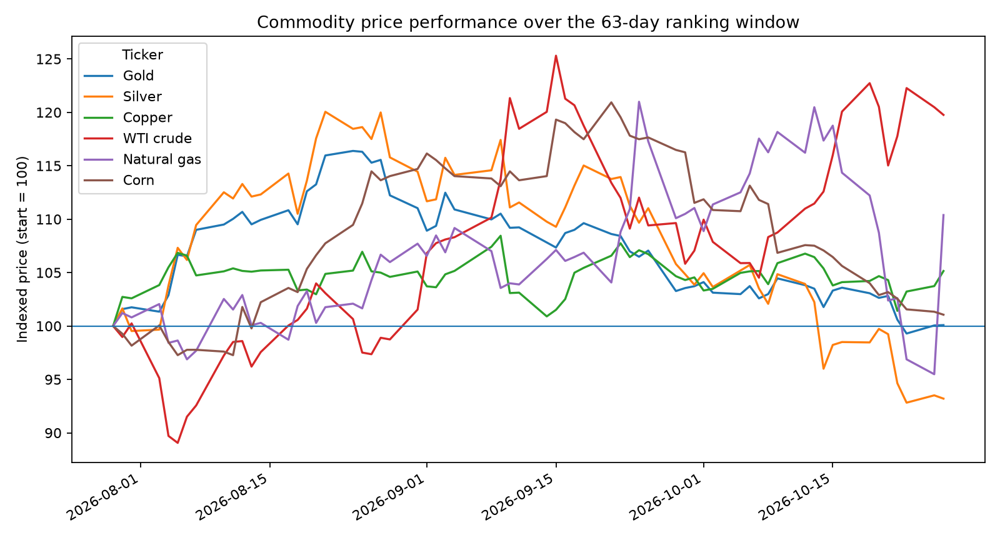
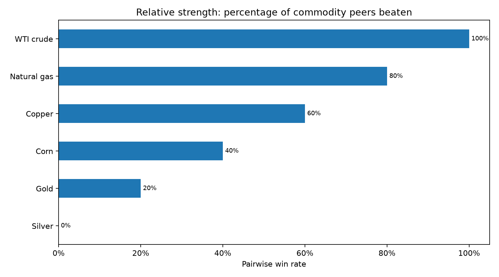
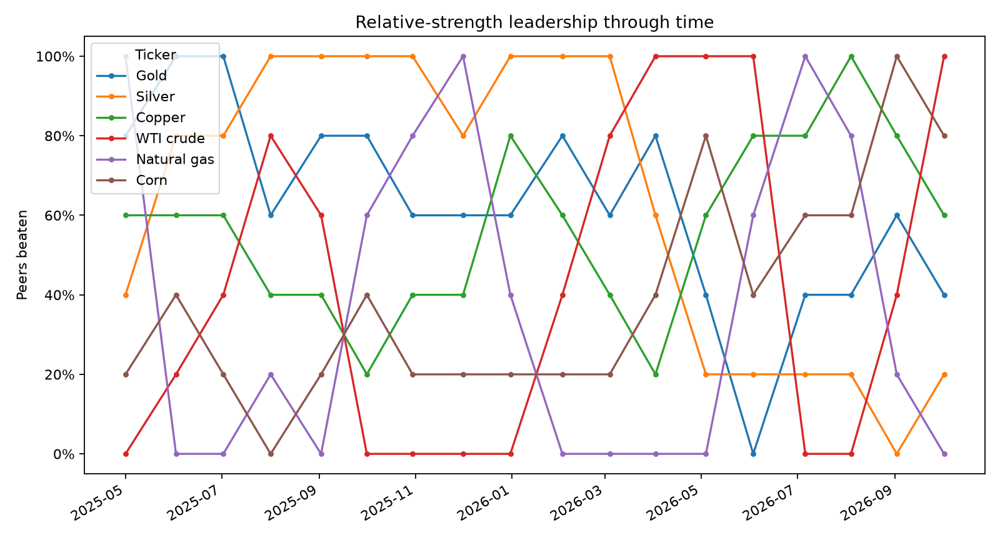

# Relative Strength & Portfolio Allocation

[](https://github.com/soulidisath/relative-strength-portfolio-allocation/actions/workflows/generate-example-figures.yml)

Personal research project exploring **cross-asset relative-strength ranking** and simple **portfolio-allocation translations** of those rankings.

The repository is a cleaned presentation of exploratory work developed while studying systematic trading. It is not a claim of live or repeatable trading profitability.

## Research questions

- Can a group of markets be ranked by comparing every pair through the trend of their price ratio?
- Can the ranking be expressed in a way that is visually and economically intuitive?
- How does leadership change through time across a defined commodity universe?
- How do ranking-derived allocations differ from a conventional mean-variance / maximum-Sharpe allocation?

## 1. Pairwise relative-strength ranking

The original `RSPS.ipynb` experiment compared each asset against every other asset. For a pair `A` and `B`, it formed the price ratio `A / B`, classified the direction of that ratio, and awarded one point to the stronger asset. Repeating that process across all pairs produced an ordered cross-asset ranking.

In the original notebook, the directional classification of each ratio came from the separate TPI trend ensemble developed in the companion market-regime repository.

The cleaned implementation in `src/relative_strength.py` keeps the ranking mechanism but makes the ratio signal pluggable. The standalone example uses transparent **63-day ratio momentum** so this repository can be understood and rerun without depending on another project.

### The score in plain English

The reproducible example uses six commodity futures: **Gold, Silver, Copper, WTI crude oil, Natural Gas, and Corn**.

Each commodity is compared with the other five. The final score is shown as the **percentage of peers it beats**:

- beats all 5 peers → **100%**
- beats 4 of 5 → **80%**
- beats 3 of 5 → **60%**
- beats 2 of 5 → **40%**
- beats 1 of 5 → **20%**
- beats none → **0%**

So an 80% relative-strength reading simply means: *over the selected lookback, this commodity's price ratio was stronger than four of the five other commodities.*

Conceptually:

```text
commodity universe
    ↓
compare every pair using A / B
    ↓
which side of each ratio was stronger?
    ↓
count pairwise wins
    ↓
convert wins to % of peers beaten
```

### First: what actually moved?



Prices are rebased to `100` at the beginning of the same 63-day window used for the final ranking. This makes the underlying market moves visible before looking at any ranking score.

### Then: who beat the most peers?



This is the simplest snapshot of the model. A bar at `80%` means that commodity beat four of its five peers in pairwise ratio comparisons.

### Leadership through time



The ranking is recalculated approximately monthly. This chart shows the percentage of peers beaten at each observation, making changes in cross-commodity leadership visible instead of showing only one final ranking.

## 2. Portfolio allocation

The allocation experiment is kept separate from the ranking logic. `src/portfolio.py` reproduces the long-only optimization used in the original research notebook:

- calculate historical simple returns;
- estimate mean returns and the covariance matrix;
- maximize mean return divided by volatility;
- solve with **SLSQP**;
- require weights to sum to one; and
- constrain every weight to the interval `[0, 1]`.

No risk-free rate, transaction cost, turnover penalty, shrinkage estimator, or estimation-error correction is included. It is therefore best viewed as a conventional mean-variance experiment rather than an institutional portfolio-construction model.

### Two different ways to turn the same market view into weights


The bars are shown directly as **portfolio percentages**:

- **Rank-derived:** take the top three relative-strength scores and normalize them to 100%.
- **Max-Sharpe:** ignore the ranking and solve the long-only historical mean/covariance optimization.

The comparison is deliberately secondary to the relative-strength charts. Its purpose is simply to show that a ranking-based view and a mean-variance view can translate the same commodity universe into very different allocations.

## Reproducible example

`examples/cross_asset_demo.py` downloads continuous front-month-style Yahoo Finance series for Gold (`GC=F`), Silver (`SI=F`), Copper (`HG=F`), WTI crude (`CL=F`), Natural Gas (`NG=F`), and Corn (`ZC=F`).

Run from the repository root:

```bash
python -m venv .venv
source .venv/bin/activate  # Windows: .venv\Scripts\activate
pip install -r requirements.txt
python examples/cross_asset_demo.py
```

A GitHub Actions workflow reruns the example in a clean Python environment after relevant source changes and refreshes the figures when necessary.

## Repository structure

```text
.
├── .github/
│   └── workflows/
│       └── generate-example-figures.yml
├── README.md
├── requirements.txt
├── examples/
│   ├── README.md
│   ├── cross_asset_demo.py
│   └── output/
│       ├── allocation_weights.png
│       ├── commodity_price_performance.png
│       ├── relative_strength_history.png
│       └── relative_strength_win_rate.png
└── src/
    ├── __init__.py
    ├── portfolio.py
    └── relative_strength.py
```

## Important limitations

This work was exploratory. In particular:

- relative-strength scores depend on the chosen universe, signal definition, and lookback;
- the standalone momentum signal is a transparent replacement for the original TPI ratio classifier, not a claim that the two are identical;
- Yahoo Finance commodity futures series are convenient research proxies and can contain roll effects; they should not be treated as clean investable total-return indices;
- historical mean returns and covariance estimates are noisy inputs to portfolio optimization;
- maximizing in-sample Sharpe can produce unstable or concentrated weights;
- the allocation example does not include transaction costs, turnover constraints, or a risk-free rate; and
- none of the figures should be interpreted as evidence of out-of-sample alpha or future profitability.

The goal of the project was to turn a discretionary idea—*which markets are stronger than their peers?*—into an explicit ranking procedure, make that ranking easy to understand visually, and then explore different ways to translate it into portfolio weights.
