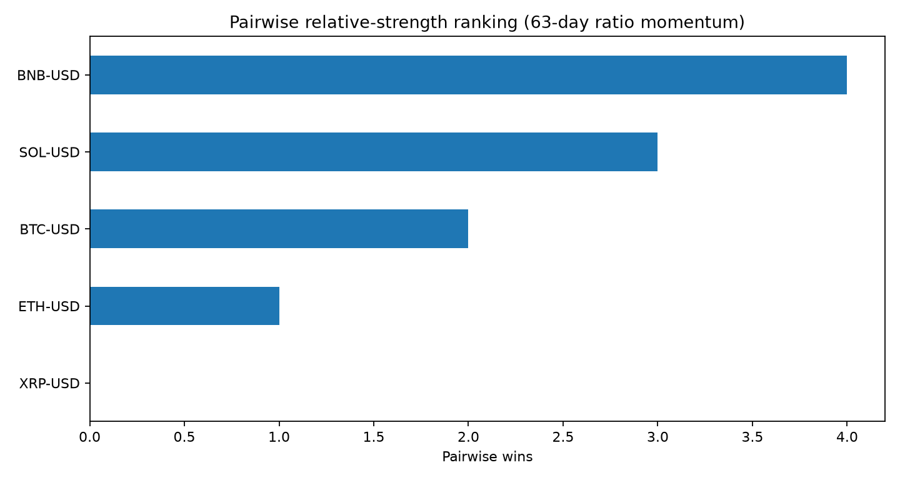
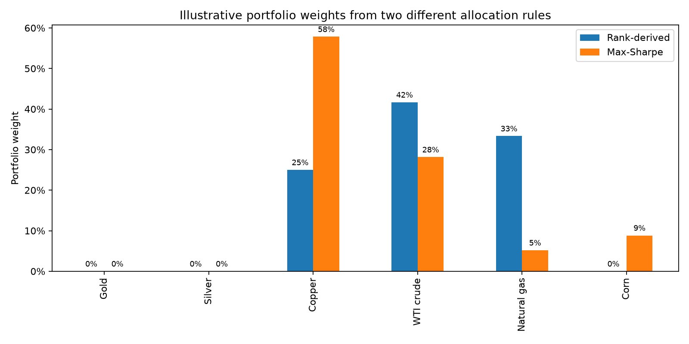

# Relative Strength & Portfolio Allocation

[](https://github.com/soulidisath/relative-strength-portfolio-allocation/actions/workflows/generate-example-figures.yml)

Personal research project exploring **cross-asset relative-strength ranking** and simple **portfolio-allocation translations** of those rankings.

The repository is a cleaned presentation of exploratory work developed while studying systematic trading. It is not a claim of live or repeatable trading profitability.

## Research questions

- Can a group of assets be ranked by comparing every pair through the trend of their price ratio?
- How stable and interpretable is a simple tournament-style ranking across a defined universe?
- How do ranking-derived allocations differ from a conventional mean-variance / maximum-Sharpe allocation?

## 1. Pairwise relative-strength ranking

The original `RSPS.ipynb` experiment compared each asset against every other asset. For a pair `A` and `B`, it formed the price ratio `A / B`, classified the direction of that ratio, and awarded one point to the stronger asset. Repeating that process across all pairs produced an ordered cross-asset ranking.

In the original notebook, the directional classification of each ratio came from the separate TPI trend ensemble developed in the companion market-regime repository.

The cleaned implementation in `src/relative_strength.py` keeps the ranking mechanism but makes the ratio signal pluggable. The standalone example uses transparent **63-day ratio momentum** so this repository can be understood and rerun without depending on another project.

Conceptually:

```text
asset universe
    ↓
all pairwise price ratios
    ↓
directional signal for each ratio
    ↓
one point to the stronger asset in each pair
    ↓
rank assets by total pairwise wins
```

### Reproducible ranking example



The chart shows the pairwise tournament score for a small liquid crypto universe. It is a ranking diagnostic, not a performance chart.

## 2. Portfolio allocation

The allocation experiment is kept separate from the ranking logic. `src/portfolio.py` reproduces the long-only optimization used in the original research notebook:

- calculate historical simple returns;
- estimate mean returns and the covariance matrix;
- maximize mean return divided by volatility;
- solve with **SLSQP**;
- require weights to sum to one; and
- constrain every weight to the interval `[0, 1]`.

No risk-free rate, transaction cost, turnover penalty, shrinkage estimator, or estimation-error correction is included. It is therefore best viewed as a conventional mean-variance experiment rather than an institutional portfolio-construction model.

### Two ways to translate the same universe into weights



The example contrasts two intentionally different constructions:

- **Rank-derived weights:** normalize the pairwise scores of the top-ranked assets.
- **Max-Sharpe weights:** solve the long-only historical mean/covariance optimization.

The comparison is meant to show how a relative-strength view and a mean-variance view can produce different allocations, not to establish that either is superior.

## Reproducible example

`examples/cross_asset_demo.py` downloads daily BTC, ETH, SOL, BNB, and XRP data through `yfinance`, calculates the pairwise ranking, and produces both figures above.

Run from the repository root:

```bash
python -m venv .venv
source .venv/bin/activate  # Windows: .venv\Scripts\activate
pip install -r requirements.txt
python examples/cross_asset_demo.py
```

A GitHub Actions workflow reruns the example in a clean Python environment after relevant source changes and refreshes the figures when necessary.

## Repository structure

```text
.
├── .github/
│   └── workflows/
│       └── generate-example-figures.yml
├── README.md
├── requirements.txt
├── examples/
│   ├── README.md
│   ├── cross_asset_demo.py
│   └── output/
│       ├── allocation_weights.png
│       └── relative_strength_ranking.png
└── src/
    ├── __init__.py
    ├── portfolio.py
    └── relative_strength.py
```

## Important limitations

This work was exploratory. In particular:

- relative-strength scores depend on the chosen universe, signal definition, and lookback;
- the standalone momentum signal is a transparent replacement for the original TPI ratio classifier, not a claim that the two are identical;
- historical mean returns and covariance estimates are noisy inputs to portfolio optimization;
- maximizing in-sample Sharpe can produce unstable or concentrated weights;
- the allocation example does not include transaction costs, turnover constraints, or a risk-free rate; and
- none of the figures should be interpreted as evidence of out-of-sample alpha or future profitability.

The goal of the project was to turn a discretionary idea—*which assets are stronger than their peers?*—into an explicit ranking procedure and then explore different ways to translate that ranking into portfolio weights.
